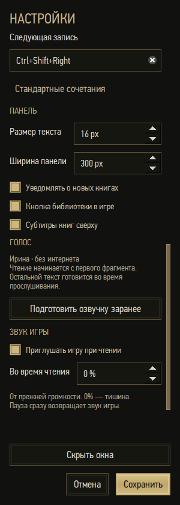
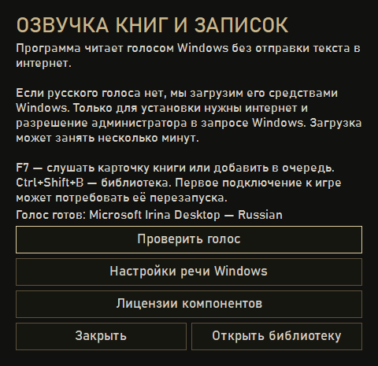

# Ведьмак 3 — озвучка текста, книг и записок

**Озвучка текста в The Witcher 3: слушайте найденные письма, книги и дневники, продолжая играть.**

Чтение вслух на русском для «Ведьмака 3» — с очередью, мини-плеером и субтитрами.

Офлайн-озвучка на русском · Windows 10/11 x64 · очередь записей · отдельные субтитры

[**Скачать установщик Windows (v0.1.3)**](https://github.com/Protozhe/witcher3-book-voice/releases/download/v0.1.3/WitcherBookVoice-0.1.3-Windows-x64-Setup.exe) · [Все файлы релиза и SHA256](https://github.com/Protozhe/witcher3-book-voice/releases/tag/v0.1.3)

[Возможности](#возможности) · [Совместимость](docs/COMPATIBILITY.md) · [Установка](docs/INSTALL.md) · [Сообщить об ошибке](https://github.com/Protozhe/witcher3-book-voice/issues/new/choose)

> **Предварительный релиз — v0.1.3.** Установщик включает приложение, Python и библиотеки. Отдельно устанавливать Python не нужно. Русский голос Windows проверяется автоматически. Если его нет, мастер начнёт загрузку через Windows Update; нужны интернет и подтверждение запроса администратора. Первичное подключение само подготавливает обычный запуск из Steam и один раз перезапускает клиент. Если игра открыта, мастер ждёт её закрытия. Вводить параметры вручную и создавать игровой ярлык не требуется. Исходники приложения остаются закрытыми. Установщик пока не подписан сертификатом; сверяйте SHA256 и скачивайте файлы только из Releases этого репозитория.

## Возможности

- Озвучка настоящих книг, писем и дневников из вашей установленной The Witcher 3.
- Одна клавиша **F7**: слушать показанную слева книгу или добавить её в очередь.
- Мини-плеер с названием, паузой, переходами, временем и перемоткой.
- Локальная библиотека и история прослушивания сохраняются между запусками.
- Приглушение только звука игры с восстановлением прежней громкости на паузе.
- Субтитры без фона в верхней части экрана, отдельно от игровых диалогов.
- Подготовка озвучки заранее; фоновая подготовка уступает ресурсы текущему чтению.
- Автоматический запуск библиотеки вместе с игрой.
- Автоматическое подключение обычного запуска из Steam при установке.
- Необязательный авторежим диалогов: новые дополнительные вопросы, затем квестовый ответ после 5 секунд бездействия.

## Для кого

Для тех, кто хочет слушать игровой лор во время путешествий, кому трудно читать мелкий текст или кто быстро устаёт от чтения. Это дополнительный инструмент доступности, а не полноценная замена игрового интерфейса или экранного диктора.

## Как это выглядит

Скриншоты показывают интерфейс тестовой версии с демонстрационным текстом. Размеры панели и сочетания клавиш можно менять.

## Управление

| Клавиша | Действие |
|---|---|
| **F7** | Озвучить книгу текущей карточки / добавить её в очередь |
| **Ctrl+Shift+B** | Открыть или скрыть библиотеку |
| **Ctrl+Shift+P** | Пауза / продолжить |
| **Ctrl+Shift+S** | Остановить чтение и очистить очередь |
| **Ctrl+Shift+←** | Предыдущая запись |
| **Ctrl+Shift+→** | Следующая запись из очереди |
| **Ctrl+Shift+D** | Включить / выключить авторежим диалогов |

Повторное F7 не ставит аудио на паузу и не создаёт дубликат. Если очередь пуста, переход вперёд ничего не запускает. Если сочетание занято другой программой, его можно переназначить.

Авторежим диалогов по умолчанию выключен. Сначала он задаёт новые дополнительные вопросы, затем выбирает квестовый ответ. Если остались только товары, услуги, выход или уже заданные дополнительные вопросы, ждёт ручного выбора. В сценах на время и при особых решениях выбирается верхний доступный ответ, включая решения с последствиями. Каждое ручное переключение ответа заново откладывает автоматический выбор на пять секунд. Сворачивание игры приостанавливает режим. Кратковременные ошибки связи не показываются плашкой поверх игры; сведения о подключении доступны в настройках.

## Совместимость

| Платформа | Статус |
|---|---|
| Windows 10/11, x64 | Целевая платформа; локальные проверки выполнены на Windows. Полная матрица устройств ещё не пройдена. |
| Windows 7/8, Windows ARM | Не заявлены |
| Linux / Steam Deck / Proton | Планируется; готовой проверенной Linux-версии пока нет |
| macOS | Не поддерживается |

Нет гарантии работы на любой версии Windows или Linux. Разные оконные менеджеры, Wayland/X11, Proton, моды и игровые версии требуют отдельных проверок. Подробности — в [таблице совместимости](docs/COMPATIBILITY.md).

## Офлайн и нагрузка

Публичная версия использует русский голос Windows (Microsoft SAPI или OneCore). Модель Ирины/Piper и ресурсы игры в установщик не включены. Голос работает локально и не требует GPU. Если русского голосового пакета нет, мастер один раз установит его через Windows Update. Подтвердите запрос администратора; после установки чтение работает офлайн. При отмене или ошибке загрузки можно повторить установку в мастере. Политики Windows Update могут блокировать загрузку; иногда требуется перезагрузка. Готовые аудиофрагменты используются повторно.

Объём полной подготовки зависит от скорости и каталога; ориентир — около 2 ГБ. Подготовку пользователь запускает сам. Точность ударений и синхронизация субтитров пока не идеальны: субтитры рассчитываются приблизительно внутри аудиофрагмента.

## Важное о заданиях

**«Прослушано» в библиотеке и «прочитано» в игре — разные состояния.** Если задание требует прочитать книгу, откройте её штатным способом в игре. Одно прослушивание не должно автоматически выполнять задания.

## Планы

- [x] Очередь, мини-плеер, перемотка и субтитры.
- [x] Подготовка аудио и сохранение истории локально.
- [x] Автоматическое обнаружение установленной игры на Windows.
- [x] Windows-установщик с автоматической установкой русского голоса Windows, лицензиями и исходниками сторонних LGPL-библиотек.
- [ ] Отдельный Linux-бэкенд горячих клавиш, процессов и аудио.
- [ ] Проверки на Steam Deck, X11, Wayland и нескольких Proton-префиксах.
- [ ] Улучшение произношения и точности субтитров.

## Ошибки и предложения

Создайте [issue](https://github.com/Protozhe/witcher3-book-voice/issues/new/choose), укажите версию ОС, игры и приложения, шаги воспроизведения и скриншот. Не публикуйте сохранения, личные пути и полный журнал без проверки: в них могут быть личные данные. См. [устранение неполадок](docs/TROUBLESHOOTING.md).

## Распространение

Исходный код приложения закрыт. Этот репозиторий содержит публичную документацию и материалы проекта; открытая лицензия на код приложения здесь не предоставляется. Сторонние компоненты имеют собственные лицензии.

Проект неофициальный и не связан с CD PROJEKT RED. The Witcher и игровые материалы принадлежат соответствующим правообладателям. Тексты, графика, шрифты игры, пользовательские сохранения и база прослушивания в этот репозиторий не включены. Подробнее: [сторонние материалы](THIRD_PARTY_NOTICES.md).
