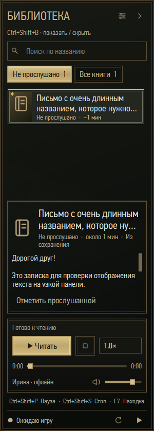
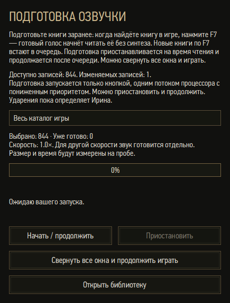

# Озвучка записок и книг — Ведьмак 3

**Слушайте найденные письма, книги и дневники, продолжая играть.**

Офлайн-озвучка на русском · очередь записей · игровой мини-плеер · отдельные субтитры

[Возможности](#возможности) · [Совместимость](docs/COMPATIBILITY.md) · [Установка](docs/INSTALL.md) · [Сообщить об ошибке](../../issues/new/choose)

> **Статус: закрытое тестирование.** Здесь опубликована страница проекта, документация и трекер ошибок. Исходный код приложения не опубликован. Общедоступный установщик пока не выпущен; не скачивайте сборки из сторонних комментариев.

## Возможности

- Озвучка настоящих книг, писем и дневников из вашей установленной The Witcher 3.
- Одна клавиша **F7**: слушать показанную слева книгу или добавить её в очередь.
- Мини-плеер с названием, паузой, переходами, временем и перемоткой.
- Локальная библиотека и история прослушивания сохраняются между запусками.
- Приглушение только звука игры с восстановлением прежней громкости на паузе.
- Субтитры без фона в верхней части экрана, отдельно от игровых диалогов.
- Подготовка озвучки заранее; фоновая подготовка уступает ресурсы текущему чтению.
- Автоматический запуск библиотеки вместе с игрой.

## Для кого

Для тех, кто хочет слушать игровой лор во время путешествий, кому трудно читать мелкий текст или кто быстро устаёт от чтения. Это дополнительный инструмент доступности, а не полноценная замена игрового интерфейса или экранного диктора.

## Как это выглядит

Скриншоты показывают интерфейс тестовой версии с демонстрационным текстом. Размеры панели и сочетания клавиш можно менять.

## Управление

| Клавиша | Действие |
|---|---|
| **F7** | Озвучить книгу текущей карточки / добавить её в очередь |
| **Ctrl+Shift+B** | Открыть или скрыть библиотеку |
| **Ctrl+Shift+P** | Пауза / продолжить |
| **Ctrl+Shift+S** | Остановить чтение и очистить очередь |
| **Ctrl+Shift+←** | Предыдущая запись |
| **Ctrl+Shift+→** | Следующая запись из очереди |

Повторное F7 не ставит аудио на паузу и не создаёт дубликат. Если очередь пуста, переход вперёд ничего не запускает. Если сочетание занято другой программой, его можно переназначить.

## Совместимость

| Платформа | Статус |
|---|---|
| Windows 10/11, x64 | Целевая платформа; локальные проверки выполнены на Windows. Полная матрица устройств ещё не пройдена. |
| Windows 7/8, Windows ARM | Не заявлены |
| Linux / Steam Deck / Proton | Планируется; готовой проверенной Linux-версии пока нет |
| macOS | Не поддерживается |

Нет гарантии работы на любой версии Windows или Linux. Разные оконные менеджеры, Wayland/X11, Proton, моды и игровые версии требуют отдельных проверок. Подробности — в [таблице совместимости](docs/COMPATIBILITY.md).

## Офлайн и нагрузка

Тестовая версия использует локальный русский голос Ирина через Piper / sherpa-onnx. После установки голос работает без интернета, синтез использует один поток CPU; GPU не требуется. Первый запуск голоса и создание ещё не подготовленного текста требуют времени. Готовые фрагменты используются повторно.

Объём полной подготовки зависит от скорости и каталога; ориентир — около 2 ГБ. Подготовку пользователь запускает сам. Точность ударений и синхронизация субтитров пока не идеальны: субтитры рассчитываются приблизительно внутри аудиофрагмента.

## Важное о заданиях

**«Прослушано» в библиотеке и «прочитано» в игре — разные состояния.** Если задание требует прочитать книгу, откройте её штатным способом в игре. Одно прослушивание не должно автоматически выполнять задания.

## Планы

- [x] Очередь, мини-плеер, перемотка и субтитры.
- [x] Подготовка аудио и сохранение истории локально.
- [x] Автоматическое обнаружение установленной игры на Windows.
- [ ] Публичный Windows-релиз после проверки состава дистрибутива и лицензий.
- [ ] Отдельный Linux-бэкенд горячих клавиш, процессов и аудио.
- [ ] Проверки на Steam Deck, X11, Wayland и нескольких Proton-префиксах.
- [ ] Улучшение произношения и точности субтитров.

## Ошибки и предложения

Создайте [issue](../../issues/new/choose), укажите версию ОС, игры и приложения, шаги воспроизведения и скриншот. Не публикуйте сохранения, личные пути и полный журнал без проверки: в них могут быть личные данные. См. [устранение неполадок](docs/TROUBLESHOOTING.md).

## Распространение

Исходный код приложения закрыт. Этот репозиторий содержит публичную документацию и материалы проекта; открытая лицензия на код приложения здесь не предоставляется. Сторонние компоненты имеют собственные лицензии.

Проект неофициальный и не связан с CD PROJEKT RED. The Witcher и игровые материалы принадлежат соответствующим правообладателям. Тексты, графика, шрифты игры, пользовательские сохранения и база прослушивания в этот репозиторий не включены. Подробнее: [сторонние материалы](THIRD_PARTY_NOTICES.md).
